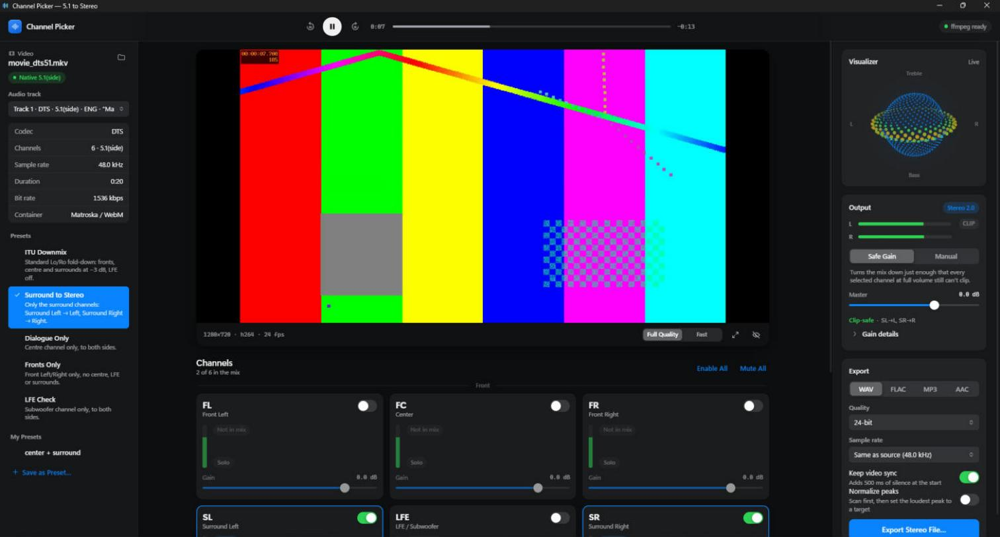
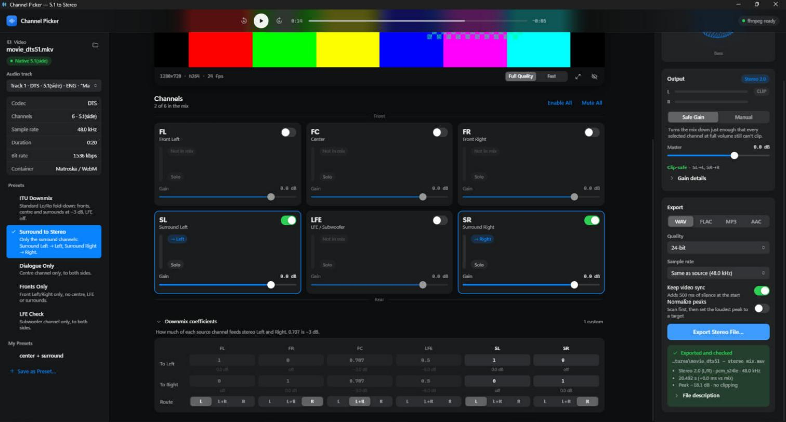
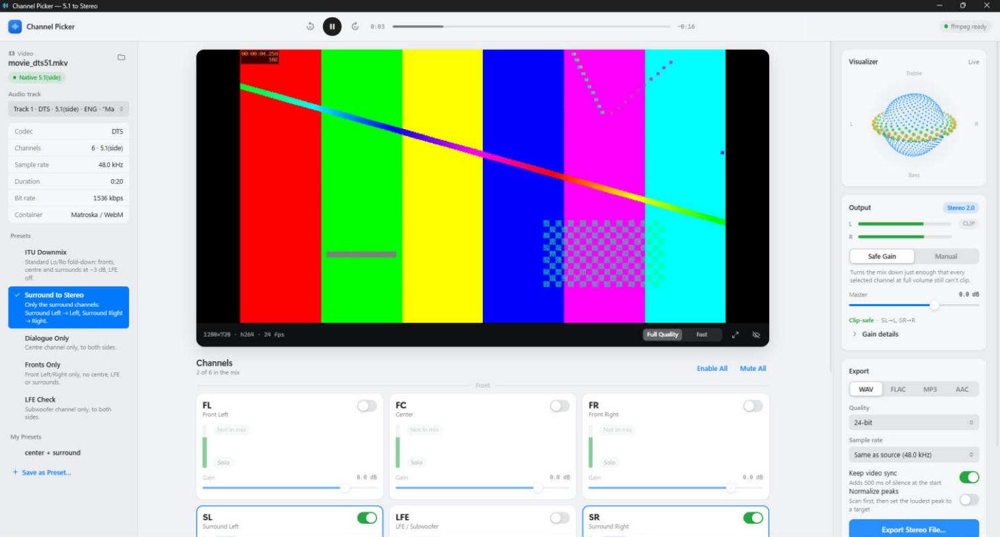

<p align="center">
  
</p>

<h1 align="center">Channel Picker</h1>

<p align="center">
  Pick channels from a 5.1 movie soundtrack and mix them to stereo.<br>
  <a href="https://github.com/madesh-ops/channel-picker/releases/latest"><b>Download for Windows</b></a>
</p>

A Windows desktop app for listening to individual channels of a 5.1 movie soundtrack on ordinary
stereo speakers or headphones. Open a video or audio file, choose which of **FL, FR, Center, LFE,
SL and SR** to keep, preview the mix live, and export a standard **two-channel stereo** file.

Example: the **Surround to Stereo** preset mutes the front, centre and LFE channels and sends
Surround Left → Left and Surround Right → Right, so you hear only the rear-channel content.

Built with [Tauri 2](https://tauri.app) (Rust) and React. ffmpeg does the decoding and encoding.

## Screenshots


*Previewing a DTS 5.1 movie with **Surround to Stereo**, picked from the preset list in the sidebar.
The video plays in sync and the orb reacts on the left and right sides.*


*Channel cards are laid out like the speakers around you: front row FL · C · FR, rear row
SL · LFE · SR. Below them, the downmix coefficients open as an advanced section. On the right, an
export checked after writing: 2 channels, stereo, exact duration, no clipping.*


*The app follows the Windows light/dark setting.*

## Install

1. Download `Channel-Picker_x.y.z_x64-setup.exe` (or the `.msi`) from
   [Releases](https://github.com/madesh-ops/channel-picker/releases/latest) and run it.
2. Install ffmpeg if you don't have it: `winget install Gyan.FFmpeg`.

The installer isn't code-signed, so Windows SmartScreen may show *"Windows protected your PC"* the
first time. Choose **More info → Run anyway**.

## Features

- **Source detection** – codec, profile, channel count and layout for every audio track
  (DTS / DTS-HD MA, Dolby Digital, Dolby Digital Plus, TrueHD, AAC, FLAC, PCM, …).
  Native multichannel sources are clearly marked apart from stereo ones.
- **Channel selection** – switch each channel on or off, solo it, and set its gain. The cards are
  arranged in speaker positions so it's clear which one is which.
- **Downmix coefficients** – edit how much of each channel feeds Left and Right
  (ITU-R BS.775 Lo/Ro defaults).
- **No clipping** – *Safe gain* scales the mix so full-scale input on every selected channel cannot
  clip; optional peak normalization on export.
- **Live preview** – changes are heard immediately; meters, a clip indicator, and a
  sound-reactive dot-matrix orb (bass at the bottom, treble at the top, L/R on each side).
  Space plays and pauses; the seek bar shows time remaining and has ±10 s skip buttons.
- **Video preview** – for video files, the picture is shown in sync with the audio at full
  resolution, with full screen and a lighter *Fast* mode. Works with any container ffmpeg reads
  (MKV, M2TS, AVI, MP4, …).
- **Export** – WAV (16/24-bit, 32-bit float), FLAC (16/24-bit), MP3 (320 kbps / V0), AAC (.m4a).
  Full duration is kept; video sync can be preserved with lead-in silence. Every export is
  re-checked (2 channels, stereo layout, duration). Output is always plain stereo – never labelled
  as DTS or 5.1.
- **Presets** – built-ins (ITU Downmix, Surround to Stereo, Dialogue Only, Fronts Only, LFE Check)
  plus your own saved presets. Presets work across 5.1 and 5.1(side) layouts.

## Requirements

- Windows 10/11
- **ffmpeg and ffprobe** on `PATH` (e.g. `winget install Gyan.FFmpeg`), or point the app at the
  folder containing them. DTS/TrueHD decoding depends on your ffmpeg build; the start screen shows
  what's available.

## Development

```bash
npm install
npm run tauri dev      # run the app
npm run tauri build    # build installers into src-tauri/target/release/bundle
cd src-tauri && cargo test
```

The end-to-end tests generate test media with ffmpeg (one tone per channel) and check that each
export contains only the selected channels. `scripts/make_fixtures.sh` creates the same kind of
files in `fixtures/` for manual testing.

## Layout

| Path | What it does |
|---|---|
| `src-tauri/src/probe.rs` | ffprobe → codec, layout, native multichannel vs stereo |
| `src-tauri/src/layout.rs` | channel layouts, labels and roles |
| `src-tauri/src/mix.rs` | the mix matrix, safe gain, peak meters (shared by preview and export) |
| `src-tauri/src/preview.rs` | live audio preview, spectrum, synced video frames |
| `src-tauri/src/export.rs` | decode → mix → encode pipeline, normalization, verification |
| `src-tauri/src/presets.rs` | built-in and saved presets |
| `src/` | React UI |
